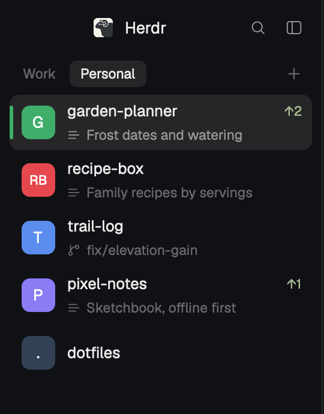

# Grouped Spaces for Herdr

Split Herdr's Spaces sidebar into **Work** and **Personal**, give each space a description, and
choose its avatar letter and color.



- **Work | Personal switch:** shows one group at a time, and the agents list follows it. A dot
  on the hidden group tells you when an agent there needs you.
- **Swipe between groups:** a two-finger sideways swipe over the sidebar drags the list with
  your fingers and switches group on release, like Arc's sidebar.
- **Two-line cards:** avatar, name and description, plus the branch and ahead/behind counts. The
  avatar's corner shows the space's agent status.
- **Customize:** name, description, letter, color and group, in one dialog. Open it by
  double-clicking a space, from the right-click menu, or with `cmd-shift-r`. Tab moves between
  the fields.

## Install

```sh
git clone <this repo> ~/Dev/Projects/herdr-mods
~/Dev/Projects/herdr-mods/grouped-spaces/install.sh     # links into ~/.config/herdr-app
herdr-app do layout.switch --name grouped-spaces
```

The script links rather than copies, so `git pull` updates the running app; use
`./install.sh --copy` for a copy you'll change on its own. It never overwrites existing files.
Add the key it prints to `keys.json`. `ctrl-shift-l` switches back to your previous layout.

Want existing spaces sorted by folder on the first run? Add path fragments to `WORK_FOLDERS`
at the top of `mods/grouped-spaces/main.js`. Otherwise they all start in Work, and you move
them with right-click → Move to Personal.

## Uninstall

Delete `mods/grouped-*` and `layouts/grouped-spaces.json` from `~/.config/herdr-app`, and remove
the key. Your descriptions, letters and groups stay in Herdr's `shared.json`, unused.

## Develop

Edit the files here and Herdr reloads them on save. Run `herdr-app check mods/<name>` after
every change. `RECIPE.md` describes the whole build, behaviour and shared-state keys, so it's
the brief for rebuilding this pack or changing it with an agent.
