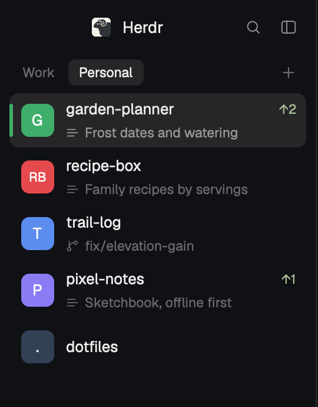

# Grouped Spaces

Herdr's main layout with a Spaces sidebar split into **Work** and **Personal**. One switch at
the top shows one group at a time, and the agents list follows it. Each space is a two-line card:
a large colored avatar whose letter and color you choose, its name, and a short description of
what it's for. Change any of these in a Customize dialog (double-click, right-click or
`cmd-shift-r`). This suits people who keep several long-lived worktrees ("alpha", "beta", ...)
and want to see what each one is doing without renaming it.

## What you see

Everything outside the sidebar's two lists is Herdr's `main` layout, unchanged: the brand bar,
the tab pills, pane cards, Files and Changes panels, and the status bar.

**Spaces header (31px).** Two pills, `Work` and `Personal`, 22px high and 11.5px text. The shown
group's pill has the `selected` background in `foreground` text; the other is `dim`. A 6px dot
in `blocked` color follows the hidden pill when a space in that group is blocked or done. A `+`
on the right makes a new space.

**Space rows (46px each, all the same height).** From the left:

- When active: a 3px bar on the left edge, inset 9px top and bottom, in the space's own color.
  The row has the `selected` background and 8px corners.
- **Avatar:** 28px (24px for a worktree nested under its main checkout), 7px corners, filled with
  the space's color, holding a bold white letter (13px, or 11px for two letters).
- **Status corner on the avatar:** a 9px spinner in `working` color while an agent works; an
  11px dot in `blocked` or `done` color when one needs you. Both have a 2px `chrome` ring.
- **Line 1:** the name (13px, medium weight when active), then on the right `↑n` in green
  (`ansi2`, unpushed commits) and `↓n` in `dim` (behind upstream). Both are 11px text with no box.
- **Line 2 (11.5px):** the description after a three-line text icon. With no description, the
  branch after a branch icon, unless it's main/master or matches the name. Both are `dim`
  (`muted` when active). Hovering a description shows the branch as a tooltip.

A row with nothing for line 2 keeps the 46px height, with its name centered.

**Customize dialog (420×500).** At the top, a preview of the avatar, name and description. Below
it: a Name field (selected, so typing replaces it), Description, a Letter field (1–2
characters), a custom hex color field, 11 color swatches, and a Work/Personal switch. Then
Cancel and Save.

**Space right-click menu:** `Customize…` (showing its key, `cmd-shift-r`), `Move to
Personal`/`Move to Work`, New/Open/Remove worktree for git spaces, and Close. There is no
Rename item; the name is edited in Customize.

## How it behaves

- **Switching groups** shows that group's spaces and selects the space last used there, or else
  its first space. If the group is empty, the selection stays where it is and the list offers
  "New personal space".
- **The group follows the active space:** when another way picks a space in the hidden group
  (the agents list, a toast, `space.next`), the sidebar switches to that group.
- **Agents list:** only agents whose space is in the shown group. `agent.next` / `agent.prev`
  follow that same list.
- **New spaces:** a space created while the sidebar runs joins the group shown at that moment.
  A space that existed before the mod ever ran goes by `WORK_FOLDERS` (see Watch out).
- **Rows:** a click selects the space and a drag reorders it (an accent line shows where it
  will land). A double-click or `cmd-shift-r` (active space) opens Customize, and a right-click
  opens the menu.
- **Customize:** Enter saves and Esc cancels. Saving with an empty name gives the space back
  Herdr's automatic name; an unchanged name isn't renamed. A valid `#rrggbb` beats the swatch.
- **Narrow sidebar** (under 160px, the rail): one letter button (`W`/`P`) switches groups. The
  rows are numbered as in Herdr.

## Built from

- `layouts/grouped-spaces.json`: a clone of Herdr's `main` (version 0.1.15). The `spaces` block's
  content is `{ "mod": "grouped-spaces" }` and the `agents` block's is
  `{ "mod": "grouped-agents" }`. Everything else is the shipped `workspace-chrome`, `tabs`,
  `files`, `changes`, `workspace-status` and `new-menu`.
- `mods/grouped-spaces`: a clone of the shipped `spaces` (0.1.15). The machine grouping,
  worktree nesting and git refresh are unchanged; the header, `row()`, `syncGroups()`,
  `switchGroup()` and a `nextCommand()` loop for `edit` are new. `note.svg` is the description
  icon. It also uses `mods/workspace-chrome/` icons (`git-branch`, `spinner`, `plus`, ...).
- `mods/grouped-agents`: a clone of the shipped `agents` with one filter after `agents()`.
- `mods/grouped-menu`: a clone of the shipped `menu`. For `tab: "space"` it adds the
  `grouped-space-edit` and group-move items and drops Rename.
- `mods/grouped-space-edit`: a new dialog mod, opened with props `{ id }`.
- **Shared state** (persisted in `shared.json`; every mod sees it):
  - `space.groups`: `{ [spaceId]: "work" | "personal" }`
  - `space.descriptions`: `{ [spaceId]: string }`
  - `space.letters`: `{ [spaceId]: string }`, 1–2 characters
  - `space.colors`: `{ [spaceId]: "ansi1".."ansi6" | "#rrggbb" }`, Herdr's own key, so the
    picker in the Terminals layout matches
  - `spaces.group`: the shown group
  - `spaces.last`: `{ [group]: spaceId }`
- **Commands it runs:** `space.select`, `space.move`, `space.new`, `space.rename`. The key is
  `"cmd-shift-r": "grouped-spaces.edit"` in `keys.json`.
- **External programs and network:** it runs `git` and `hc` like the shipped spaces mod. It
  makes no network calls and reads no files outside Herdr's own.

## Watch out

- `WORK_FOLDERS` at the top of `mods/grouped-spaces/main.js` is empty, so every space that
  existed before the first run starts in Work. Add path fragments (e.g. `"/code/acme/"`) to sort
  them by folder instead. It only decides the first assignment; after that, `space.groups` wins.
- The groups are fixed at two (`GROUPS` in `grouped-spaces` and the menu and dialog's own
  copies). A third group means changing all three.
- The `menu` and `agents` clones don't receive Herdr's later fixes to the shipped mods. Diff them
  against `mods/menu` / `mods/agents` after an update (their `mod.json` records `cloned_from`).
- `cmd-shift-r` is a macOS key. On Linux or Windows, bind another key, and don't take a ctrl
  letter the shell needs.
- `space.next` / `space.prev` still go through every space, and then the sidebar follows the
  space into its group.
- The Terminals layout's `picker` doesn't draw custom letters or descriptions, only colors.
- The layout's root sets `"toast": "quiet-alerts-toast"` (the [quiet-alerts](../quiet-alerts/)
  pack). Without that pack, Herdr logs a warning and shows its own `toast`; install it, or
  remove the field.

## Done when

- `herdr-app check` passes for all four mods, and `herdr-app status` shows no errors after
  `layout.switch {name: "grouped-spaces"}`.
- Clicking `Personal` shows only Personal spaces and only their agents, and selects the space
  last used there. Clicking `Work` goes back.
- Picking an agent in the other group from a toast switches the sidebar to that group.
- `cmd-shift-r` opens Customize for the active space. Saving a description shows it on line 2
  with the icon; saving a letter and color changes the avatar; clearing the name gives the
  automatic name back.
- Right-click → Move to Personal moves the space out of the Work list immediately.
- A space with a working agent shows a spinner on its avatar corner; a blocked or done one
  shows a dot.
